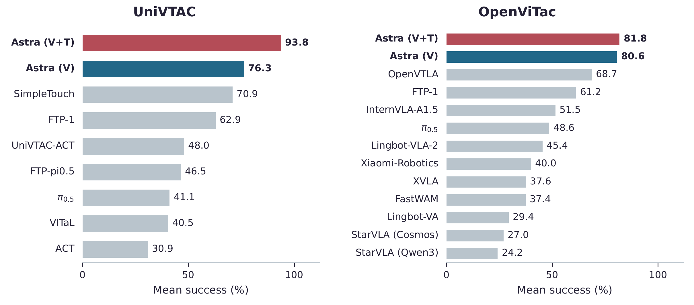

<div align="center">
  <h1>TacTalent</h1>
  <h3>GPT-6 Astra：适用于接触密集型操作的原生视觉—触觉策略</h3>
  <p>杨晨<sup>1,2</sup> · 史麟哲<sup>2</sup> · 张航<sup>2</sup> · 徐牧<sup>2</sup> · 樊健生<sup>1</sup> · 王琛<sup>1,†</sup></p>
  <p><sup>1</sup>清华大学 &nbsp; <sup>2</sup>阿里巴巴集团 · 高德<br><sup>†</sup>通讯作者</p>
  <p>
    <a href="https://tactalent.github.io/?lang=zh"></a>
    <a href="https://github.com/ccyydd/SimpleTouch"></a>
    <a href="https://tactalent.github.io/records.html?lang=zh"></a>
    <a href="https://tactalent.github.io/gallery.html?lang=zh&amp;benchmark=UniVTAC"></a>
    <a href="https://tactalent.github.io/gallery.html?lang=zh&amp;benchmark=OpenViTac"></a>
  </p>
</div>

[English](README.md) · **简体中文**

TacTalent 展示了 GPT-6 Astra **无需任务专用训练，即可直接理解视触觉图像，并利用其中的接触信息完成接触密集型操作**。我们在 **UniVTAC 的 8 项任务**与 **OpenViTac 的 11 项任务**上，研究其触觉线索理解、基于接触反馈的动作调整，以及缺少触觉时对细微视觉线索的利用能力。

我们采用 [RoboICL](https://github.com/Mosi-AI/RoboICL) 作为少样本闭环控制框架。本仓库提供 benchmark 接口、示范准备、评测脚本与操作记录审阅工具。

## 📊 实验结果

视觉—触觉输入下，Astra 在 UniVTAC 与 OpenViTac 上的平均成功率分别达到 **93.8%** 和 **81.8%**；纯视觉分别为 **76.3%** 和 **80.6%**。两种输入模式均超过下图中所比较的已报告专用模型基线。



图中为各任务等权平均成功率（%）。Astra 采用采样种子 42 的 10% 分层抽样评测，基线数值来自各 benchmark 已报告结果。完整逐任务结果与分析见[项目主页](https://tactalent.github.io/?lang=zh)。

## 🎬 视频库

在 [UniVTAC 视频库](https://tactalent.github.io/gallery.html?lang=zh&benchmark=UniVTAC)和 [OpenViTac 视频库](https://tactalent.github.io/gallery.html?lang=zh&benchmark=OpenViTac)中浏览参考示范与评测视频，并查看同步的动作说明和指令。

## 🗂️ 仓库结构

实现仅包含 UniVTAC 与 OpenViTac；两者共享 RoboICL 控制框架，各自维护任务配置和原生接口。

| 目录 | 内容 |
| --- | --- |
| `src/tactalent/roboicl/` | 示范上下文、闭环控制、评测与检查点 |
| `src/tactalent/benchmarks/` | UniVTAC 和 OpenViTac 的配置及原生接口 |
| `src/tactalent/robot/` | Panda 状态读取、运动学与 IK |
| `src/tactalent/_vendor/RoboICL/` | 固定版本、未经修改的上游运行代码 |
| `configs/` | 本地环境配置示例与额外依赖 |
| `scripts/` | 评测和专家采集入口 |
| `tests/` | 离线回归测试 |
| `docs/` | 示范准备、协议和来源说明 |

## ⚙️ 环境安装

使用配备 NVIDIA GPU 的 Linux 系统，先安装 Conda、Git LFS、FFmpeg（`ffmpeg` 和 `ffprobe`）及编译工具。当前适配针对 Python 3.10、Isaac Sim 4.5.0 和 Isaac Lab 2.1.1；两个 benchmark 分别安装到各自的 Conda 环境。从 TacTalent 仓库根目录开始：

```bash
export TACTALENT_ROOT="$(pwd)"
export TACTALENT_BENCH_ROOT="$(realpath -m ../tactalent-benchmarks)"
mkdir -p "$TACTALENT_BENCH_ROOT"
git lfs install
```

### 1. 安装 benchmark

**UniVTAC**

```bash
git clone --branch main https://github.com/univtac/UniVTAC.git \
  "$TACTALENT_BENCH_ROOT/UniVTAC"
cd "$TACTALENT_BENCH_ROOT/UniVTAC"
conda activate base
bash scripts/install.sh
conda activate UniVTAC
cd "$TACTALENT_ROOT"
```

**OpenViTac**

```bash
git clone --branch main https://github.com/FVL-Repo/OpenViTac.git \
  "$TACTALENT_BENCH_ROOT/OpenViTac"
cd "$TACTALENT_BENCH_ROOT/OpenViTac"
conda activate base
bash scripts/install.sh
conda activate OpenViTac
cd "$TACTALENT_ROOT"
```

安装脚本会准备仿真及 cuRobo、TacEx/UIPC 依赖。保留各 benchmark 随仓库提供的 TacEx 版本。详细系统要求和手动安装步骤见 [UniVTAC 安装指南](https://github.com/univtac/UniVTAC/blob/main/docs/Installation.md)和 [OpenViTac 安装指南](https://github.com/FVL-Repo/OpenViTac/blob/main/docs/Installation.md)。

### 2. 安装适配层依赖

在要评测的 benchmark 环境中，回到 TacTalent 根目录安装软件包及统一命令入口：

```bash
python -m pip install -e .
```

OpenViTac 还需要以下依赖；单独安装到项目运行目录：

```bash
python -m pip install --no-deps --target .runtime/openvitac_python \
  -r configs/requirements-openvitac.txt
export ASTRA_EXTRA_PYTHONPATH="$TACTALENT_ROOT/.runtime/openvitac_python${ASTRA_EXTRA_PYTHONPATH:+:$ASTRA_EXTRA_PYTHONPATH}"
```

### 3. 配置路径与模型接口

按照 [configs/env.example](configs/env.example) 配置本地 `.env`。将 `ASTRA_UNIVTAC_ROOT` 和 `ASTRA_OPENVITAC_ROOT` 指向上面安装的 benchmark；`ASTRA_UNIVTAC_TRAIN_CAMERA_ROOT` 应指向与示范相匹配的相机源代码。通过 `ASTRA_API_ENDPOINT` 和 `ASTRA_API_KEY` 配置完整的 HTTPS Responses endpoint 及凭据。

```bash
cp configs/env.example .env
# Edit .env for your benchmark paths and API access.
set -a
source .env
set +a
export ASTRA_PYTHON="$(command -v python)"
export PYTHONPATH="$TACTALENT_ROOT/src${PYTHONPATH:+:$PYTHONPATH}"
export OUTPUT_ROOT="${ASTRA_STORAGE_ROOT:-$TACTALENT_ROOT}"
```

切换 Conda 环境后，在该环境中安装 TacTalent，重新加载本地配置并更新 `ASTRA_PYTHON`。

## 🚀 评测

从仓库根目录运行，先列出支持的任务：

```bash
tactalent list
```

### 准备示范

按照[示范准备指南](docs/demonstrations.md)配置已校验的训练轨迹和类别覆盖 ledger，再通过统一入口生成参考示范与评测 catalog：

```bash
tactalent prepare training-config \
  --data-root "$OUTPUT_ROOT/work/datasets/UniVTAC"

tactalent prepare template \
  --output "$OUTPUT_ROOT/work/reference_sources.json"
# Configure the training ledgers described in docs/demonstrations.md.
tactalent prepare build \
  --sources "$OUTPUT_ROOT/work/reference_sources.json" --icl-mode vision_tactile
```

参考示范默认保存在 `ASTRA_STORAGE_ROOT` 下的 `references/vision_tactile/`。使用 `--icl-mode vision` 可从同一来源清单生成独立的纯视觉参考库；评测会按输入模式自动选择 catalog。输入检查、自定义输出位置和已有参考库的使用方式详见指南。

### 单集评测

```bash
tactalent eval --benchmark UniVTAC --task pull_out_key \
  --icl-mode vision_tactile \
  --reference "$OUTPUT_ROOT/references/vision_tactile/UniVTAC/pull_out_key/default/reference.json" --dry-run

GPU_ID=0 tactalent eval --benchmark UniVTAC --task pull_out_key \
  --icl-mode vision_tactile \
  --reference "$OUTPUT_ROOT/references/vision_tactile/UniVTAC/pull_out_key/default/reference.json" \
  --seed 1000000 --output "$OUTPUT_ROOT/eval_result/pull_out_key_vt"
```

### 10% 分层抽样与多 GPU 评测

先保存评测计划，再执行。同一采样种子会选取相同的 episode；`--plan-only` 不启动仿真或调用模型。

```bash
tactalent suite --benchmark UniVTAC \
  --icl-mode vision_tactile --sample-ratio 0.1 --sample-seed 42 \
  --plan-only --output "$OUTPUT_ROOT/plans/univtac_sample10_vt"

tactalent suite \
  --catalog "$OUTPUT_ROOT/plans/univtac_sample10_vt/catalog.snapshot.json" \
  --gpus 0 1 --output "$OUTPUT_ROOT/eval_result/univtac_sample10_vt"
```

OpenViTac 使用其 Conda 环境，将 `--benchmark` 改为 `OpenViTac`，并提供对应参考 catalog。10% 抽样分别为 UniVTAC 80 集、OpenViTac 130 集。完整评测省略 `--sample-ratio` 和 `--sample-seed`。

默认输入模式为 `vision_tactile`。纯视觉实验在示范准备和计划生成时均使用 `--icl-mode vision`；已保存 catalog 中的各 episode 条目确定执行时的输入模态。结果、视频、模型动作与执行记录保存在 `--output` 目录。Grasp Chip 的判定适配见[协议说明](docs/roboicl_chip_evaluation_protocol.md)。

Shell 脚本入口见 [`scripts/evaluate.sh`](scripts/evaluate.sh)；OpenViTac 官方脚本专家的采集入口见 [`scripts/collect.sh`](scripts/collect.sh)。

## 🧪 离线检查

配置 benchmark 路径后，可运行回归测试；测试不会启动仿真或调用模型：

```bash
python -m pip install -e ".[test]"
python -m pytest -q
```

## ⚖️ License

TacTalent 自身的适配与评测代码采用 [Apache License 2.0](LICENSE)。

## 🤝 Acknowledgements

感谢 [RoboICL](https://github.com/Mosi-AI/RoboICL)、[UniVTAC](https://github.com/univtac/UniVTAC) 和 [OpenViTac](https://github.com/FVL-Repo/OpenViTac) 的作者与维护者。
